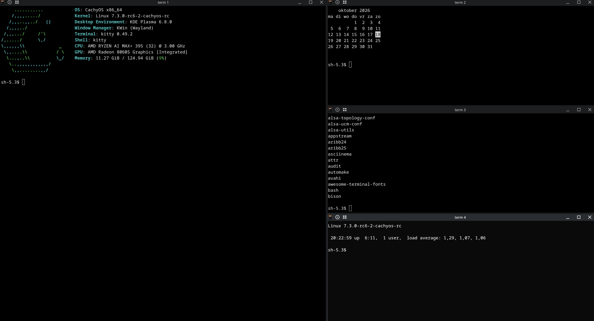
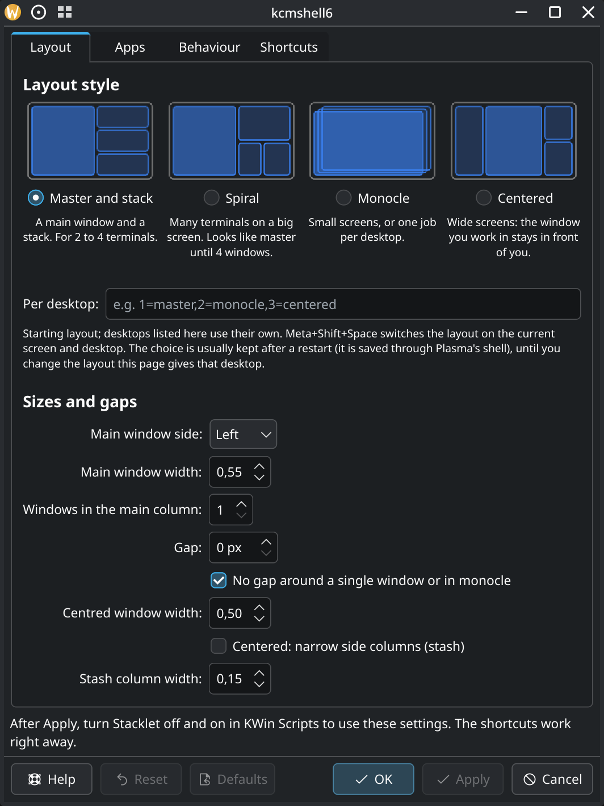

# Stacklet: tiling window manager script for KDE Plasma 6

[](https://github.com/aic0d3r/stacklet/releases)
[](https://kde.org/plasma-desktop/)
[](#install)
[](https://store.kde.org/p/2380552/)
[](LICENSE)

A small auto-tiling script made for KDE Plasma 6.8 and Wayland. It tiles your terminals i3-style (master and stack, spiral, monocle or centered master) and leaves every other window alone.

[**Get it on the KDE Store**](https://store.kde.org/p/2380552/) · [Releases](https://github.com/aic0d3r/stacklet/releases)

## Why I made it

I wanted tiling on Plasma without leaving Plasma. Kröhnkite does its own tiling instead of using Plasma's tiles. Polonium does use them, but I found both confusing and fiddly to set up.

So I wrote Stacklet, made for Plasma 6.8 and newer. It drives Plasma's native tiles, so resizing, Meta+T layouts and per-desktop tile layouts keep working. Install it, tick it in KWin Scripts, done. 

The defaults tile terminals, and you add other apps from a normal settings page.



## Features

- Only the apps you list get tiled (default: kitty, Konsole, Alacritty, Ghostty, foot, WezTerm). Everything else floats. Or tick "Tile every window" and the list becomes an exclude list.
- Four layouts, each with a preview on the settings page:
  - **Master and stack**: the first window on the left or right, the rest stacked beside it.
  - **Spiral**: each new window takes half of the space left.
  - **Monocle**: one window fills the screen.
  - **Centered master**: the main window in the middle (its own width, default 50%), the others in columns on both sides. With two windows the main one stays centred. Optional **stash**: the side columns become narrow strips (default 15% each) of small, live windows.
- Pick a starting layout, or one per screen and virtual desktop, and switch on the fly. A layout you switch to by shortcut, and widths you drag, are usually kept after a restart (see Known limits), until you change the layout the settings page gives that desktop. A lone window always fills the screen.
- **Spotlight** (Meta+Alt+C): the focused window goes to the centre, every other tiled window to the stash. Press again to get the previous layout back.
- **Scratchpad**: hide windows and call them up centred over any desktop (default 60% × 60% of the screen), one at a time.
- Settings: main width, side, 1–2 main windows, where new windows land, gap, and screens or desktops where tiling is off.
- Portrait screens get the layout turned 90°: main window on top, the rest side by side below. It re-tiles when you rotate a screen.
- Pin apps as "always main", for example a browser kept big with terminals beside it. After closing a window, focus moves to the tile before it.
- Drag the border between tiles to resize. The width sticks until that desktop has no tiled windows.



## Shortcuts

Every shortcut can be changed in System Settings → Shortcuts → KWin (search for "Stacklet").

| Key | Action |
| --- | --- |
| Meta+Shift+Return | Make the focused window the main one |
| Meta+F | Float / re-tile the focused window (dragging a tile out also floats it, unless you turn that off under Behaviour) |
| Meta+Alt+A | Tile / untile the focused window's app until restart; the on-screen note shows its window class for the settings list |
| Meta+Alt+arrows | Focus the neighbouring tile (KWin's own shortcut) |
| Meta+Alt+Shift+arrows | Swap with the neighbouring tile |
| Meta+Alt+] / Meta+Alt+[ | Grow / shrink the main window by 5% |
| Meta+Shift+Space | Switch layout (master and stack, spiral, monocle, centered) for this screen and desktop; kept after a restart |
| Meta+Shift+M | Monocle on / off for this screen and desktop: every tiled window fills the area, the focused one on top |
| Meta+Alt+. / Meta+Alt+, | Focus the next / previous tiled window (use this to cycle in monocle) |
| Meta+Alt+T / Meta+Alt+Shift+T | Rotate the stack forwards / backwards |
| Meta+Alt+C | Spotlight on / off: the focused window in the centre, the rest in the stash |
| Meta+S | Show the next scratchpad window; the press after the last one hides it |
| Meta+Ctrl+S | Send the focused window to the scratchpad; on a shown scratchpad window, put it back (tiled, or floating for apps Stacklet doesn't tile) |
| Drag a window onto another tile | Swap the two |

## Install

From the KDE Store: System Settings → Window Management → KWin Scripts → **Get New Scripts**, search for *Stacklet*, install, then tick it in the list.

Or download `stacklet-<version>.kwinscript` from [Releases](https://github.com/aic0d3r/stacklet/releases) and run `kpackagetool6 -t KWin/Script -i stacklet-<version>.kwinscript`.

From a checkout:

```sh
kpackagetool6 -t KWin/Script -i package        # first time
kpackagetool6 -t KWin/Script -u package        # update
./package.sh                                   # or build build/stacklet-<version>.kwinscript
```

Then enable **Stacklet** in System Settings → Window Management → KWin Scripts. Settings (layout, apps, sizes) are under the gear icon there; turn the script off and on to apply them. The shortcuts work right away.

Don't run it together with another tiling script (Kröhnkite, Polonium, …).

## Bugs and ideas

Found a bug? [Open an issue](https://github.com/aic0d3r/stacklet/issues/new/choose). Questions and ideas go in [Discussions](https://github.com/aic0d3r/stacklet/discussions). This is a personal project, so replies may take a day or two.

<details>
<summary><h2>Tests</h2></summary>

```sh
node test.js
```

Checks the layout math.

```sh
tests/stress/run.sh            # or: tests/stress/run.sh spiral
```

Crash stress test: runs Stacklet in a private virtual KWin (its own D-Bus session, config and script folder, your session is not touched) and opens and closes a few hundred windows in each layout. It fails if KWin dies. Needs `kwin_wayland`, `dbus-run-session`, `qdbus6` and python3 with PyQt6. It exists because holding windows in a `WeakSet`/`WeakMap` crashed KWin when a window closed.

```sh
tests/layouts/run.sh            # where do 2, 3, 4 and 6 windows end up in each layout?
```

Same private virtual KWin. It prints every window's position and fails if a layout has the wrong shape (for example monocle not stacking windows). To reproduce a setup, pass your own kwinrc section: `KWINRC=$'[Script-stacklet]\nlayoutSpiral=true' tests/layouts/run.sh - 5`.

```sh
tests/shortcuts/run.sh         # fires every shortcut and checks what it did, and that its key is free
```

Same private virtual KWin, with four windows. It also starts from a 1.0.0-style saved config, to check that upgrading picks up the new keys. It sees a fresh Plasma's KWin and service shortcuts (Spectacle, screen reader, …) but not plasmashell's, so check new keys against `kglobalshortcutsrc` too.

```sh
tests/dialogs/run.sh           # do dialogs, About boxes and tool windows stay floating?
```

Same private virtual KWin, with the app list and with "Tile every window". It opens two normal windows plus dialogs (with and without a parent), an About box, a tool window and a fixed-size window, and fails if anything but the normal windows (and the parentless dialog, see Known limits) gets a tile.

```sh
tests/activities/run.sh        # does a window on another Activity leave a gap?
```

Same private virtual KWin, plus Plasma's activity service with a second Activity. It moves one of three windows there and checks that the stack closes up, that the window tiles alone on its Activity, and that switching back keeps the layout.

The settings page is checked by hand in a live Plasma session.

</details>

## Known limits

- Windows on all desktops, minimized or fullscreen are left alone, and so are windows hidden from both the taskbar and the task switcher (helpers such as Xwayland Video Bridge).
- Dialogs, About boxes and tool windows that belong to a parent window never tile, and neither do windows that can't be resized. A dialog an app opens without a parent looks like a normal window on Wayland, so it tiles: Meta+F floats it.
- Settings apply when the script is loaded: turn Stacklet off and on in KWin Scripts after changing them.
- Spiral looks the same as master and stack until the fourth window.
- Stacklet replaces the Meta+T tile layout on every desktop where it tiles a window.
- Saved layouts and widths are written through Plasma's shell (KWin scripts can't write their config), so nothing is saved while plasmashell isn't running. A width still resets when its desktop has no tiled windows, which usually happens when you log out.
- Scratchpad windows are minimized while hidden, so they stay in the taskbar; restoring one from there shows it.

## Say thanks

If Stacklet saves you some window shuffling, [star it on GitHub](https://github.com/aic0d3r/stacklet) or rate it on the [KDE Store](https://store.kde.org/p/2380552/). That helps other people find it. If you want to chip in, you can [sponsor me on GitHub](https://github.com/sponsors/aic0d3r).

## License

GPL-3.0-or-later. See [LICENSE](LICENSE).
